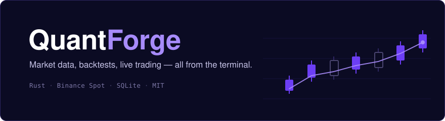
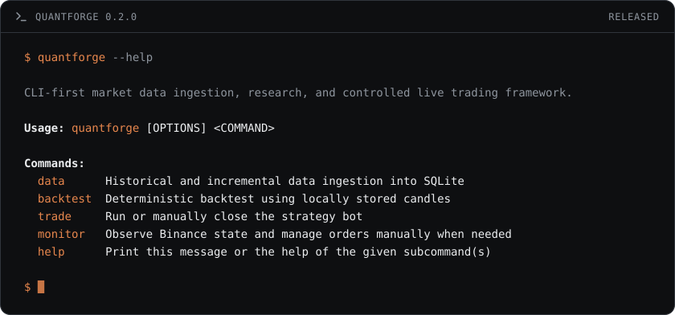

<div align="center">

<a href="https://github.com/quantforge-rs/quantforge"></a>

**A trading framework for Rust. Pull in market data, backtest a strategy, run it live — all from the terminal.**

<p>
  <a href="https://quantforge.rs"></a>
  <a href="https://github.com/quantforge-rs"></a>
</p>
<p>
  <a href="https://crates.io/crates/quantforge"></a>
  <a href="https://docs.rs/quantforge"></a>
  <a href="https://github.com/quantforge-rs/quantforge/blob/main/LICENSE"></a>
  <a href="https://github.com/quantforge-rs/quantforge"></a>
  <a href="https://github.com/quantforge-rs/quantforge/actions/workflows/ci.yml"></a>
</p>

QuantForge ingests candles into SQLite, replays them through a strategy bar by bar, and — when you explicitly ask it to — sends the same strategy's orders to a real exchange. Binance Spot and SQLite today, one Cargo package, MIT.

There is no UI. The CLI is the product.

</div>

- **Dry-run can't trade, by construction.** It isn't a flag you might forget — in dry-run the engine has no exchange attached at all.
- **Backtests are reproducible.** The same data and settings give the same result every run. No clock, no randomness, no network.
- **No floating point for money.** Everything is decimal, because `f64` quietly loses cents.
- **It refuses the wrong resume.** Change the market, the strategy or the mode and it stops, so a paper position can never turn into a real one.
- **Built to be trusted with money.** No `unsafe`, no `unwrap()`, half the codebase is tests, CI on Linux, macOS and Windows.
- **Strategies don't have to be Rust.** The interface is plain data in and plain data out, so other languages can plug in.

<div align="center">

**[quantforge.rs](https://quantforge.rs)** · **[docs.rs](https://docs.rs/quantforge)** · `cargo install quantforge`

<sub>Engineering software. Not investment advice, and no promise of profit.</sub>

</div>

<hr/>

<h2 align="center">⚡ Quickstart</h2>

```bash
cargo install quantforge --locked

# pull a month of one-minute candles into SQLite
quantforge data sync --symbol BTCUSDT --interval 1m --start 2026-08-01T00:00:00Z --end 2026-09-01T00:00:00Z

# replay an SMA crossover over them — same input, same numbers, every time
quantforge backtest --symbol BTCUSDT --interval 1m --fast 20 --slow 50 --cash 10000

# run the same strategy against live candles, with no exchange attached
quantforge trade run --symbol BTCUSDT --interval 1m --fast 20 --slow 50 --mode dry-run
```

<div align="center">

<sub>Dry-run is the default and cannot place an order. Live needs <code>--mode live</code>, <code>QF_BINANCE_API_KEY</code> and <code>QF_BINANCE_API_SECRET</code>, and a typed <code>yes</code> — point <code>QF_BINANCE_BASE_URL</code> at <code>https://testnet.binance.vision/</code> first.</sub>

</div>

<hr/>

<h2 align="center">📦 Repositories</h2>

| Repo | Lang | What it does | Links |
|---|---|---|---|
| [`quantforge`](https://github.com/quantforge-rs/quantforge) | Rust | the framework — data ingestion, deterministic backtests and guarded live trading in one CLI | [crates.io](https://crates.io/crates/quantforge) · [docs.rs](https://docs.rs/quantforge) |

<hr/>

<h2 align="center">🗺️ Roadmap</h2>

🔸 **Exchanges:** Binance Spot today, Bybit next — the venue sits behind a trait, so the engines don't change.<br/>
🔸 **Storage:** SQLite today, Postgres alongside it, same `CandleStore` and journal boundary.<br/>
🔸 **Reconciliation:** on restart, compare local run state against what the exchange actually holds before doing anything.<br/>
🔸 **Strategies:** richer indicators and more built-ins than the SMA crossover example.<br/>
🔸 **Research:** parameter sweeps and snapshot reports, so a result you liked can be reproduced later.<br/>
🔸 **Beyond Rust:** the `Strategy` trait is object-safe with no generics and no lifetimes — values in, values out, so a strategy in another language can sit behind FFI.

<hr/>

<h2 align="center">⚒️ Built with ⚒️</h2>

<div align="center">
  
</div>

<hr/>

<div align="center"><sub>MIT licensed · Rust 1.85+ · more repos are being opened up as they stabilize.</sub></div>
